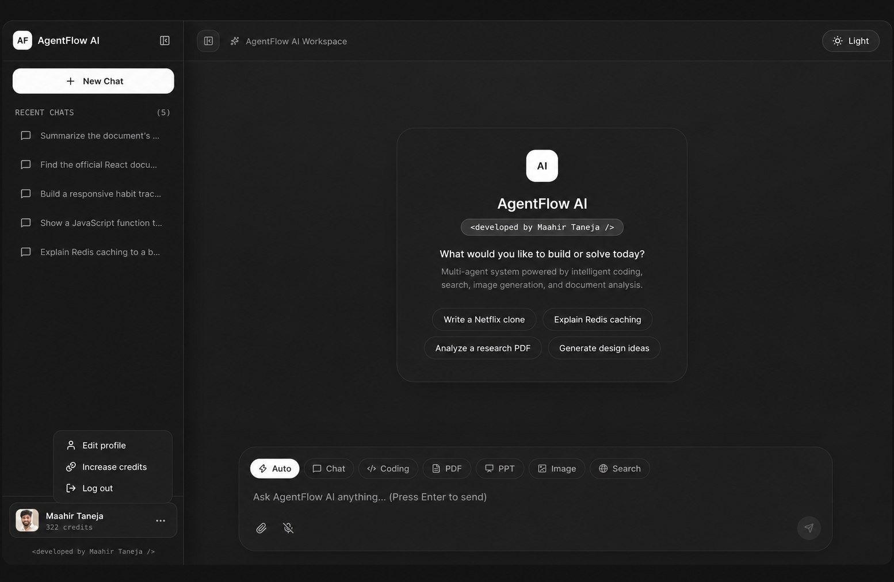
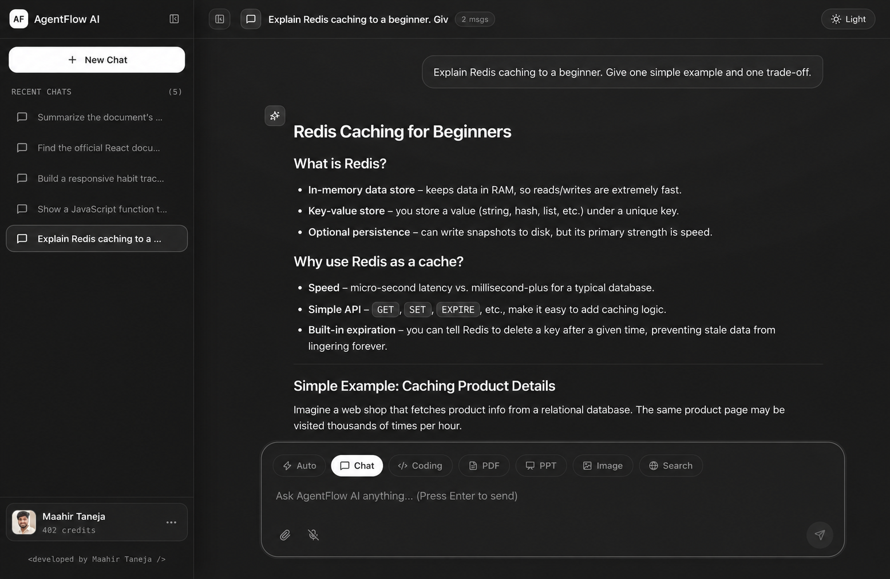
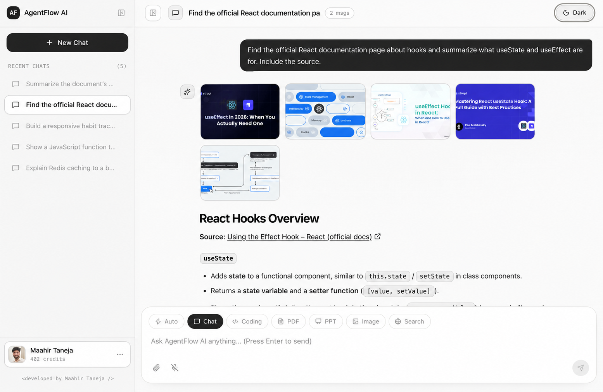
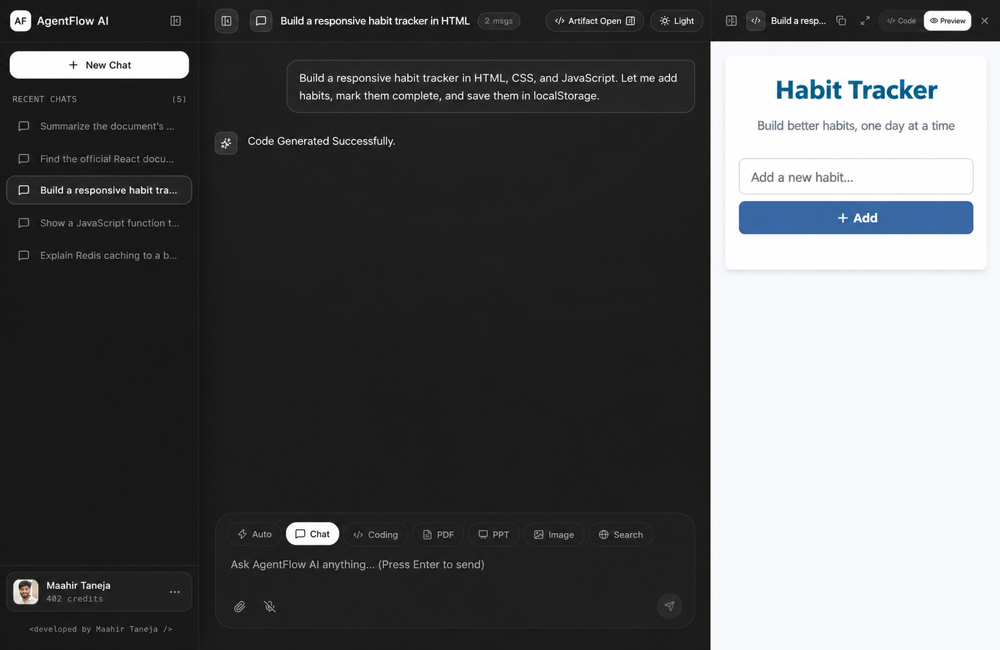
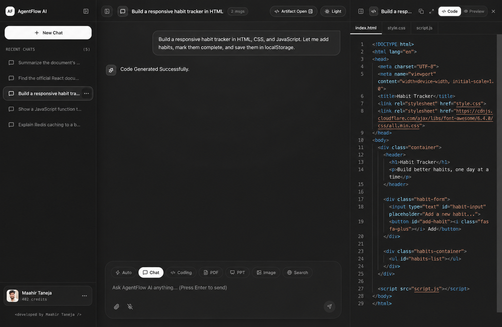
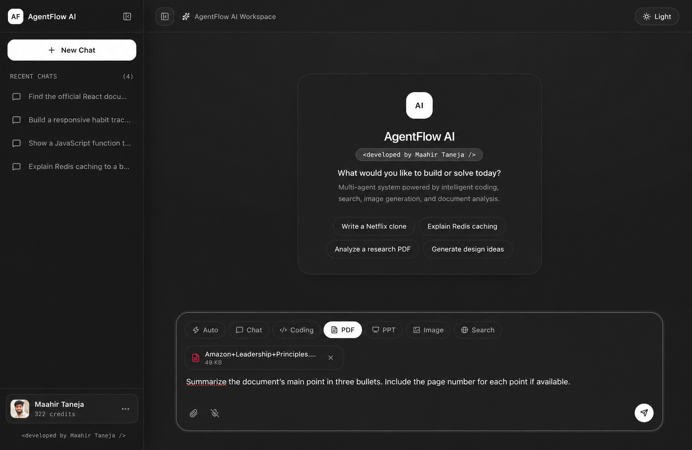
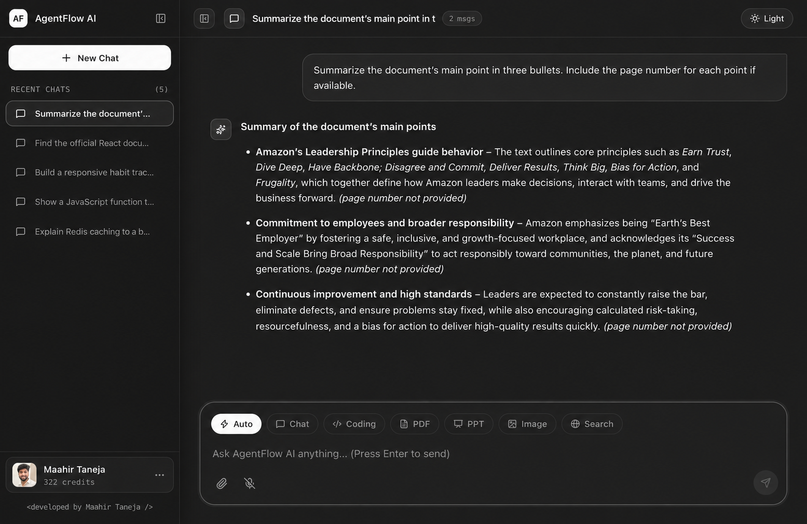
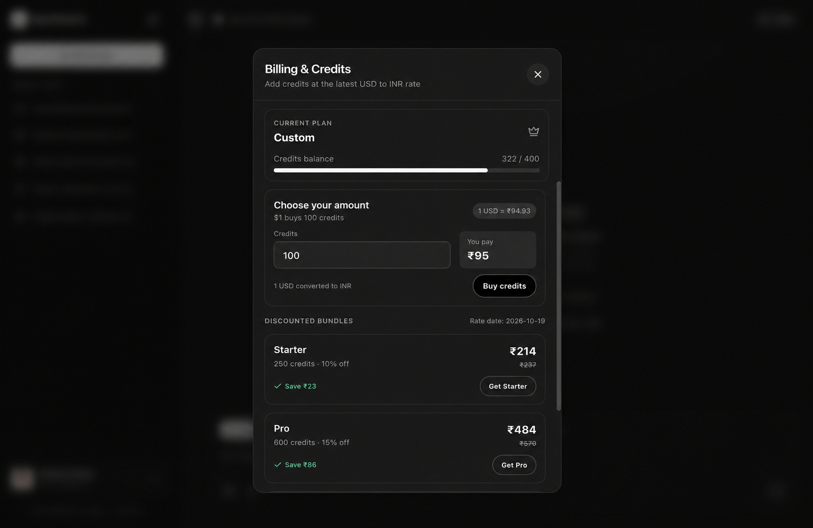
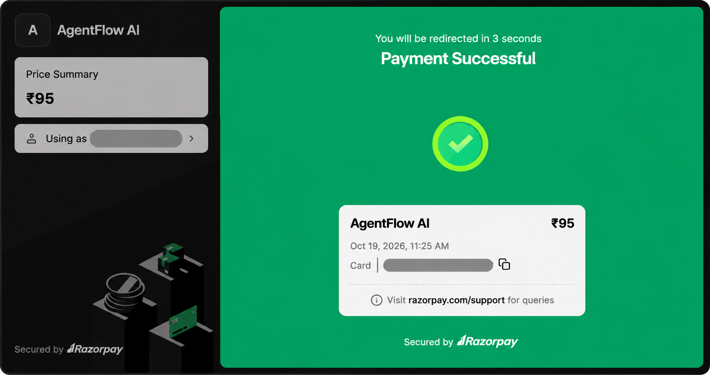
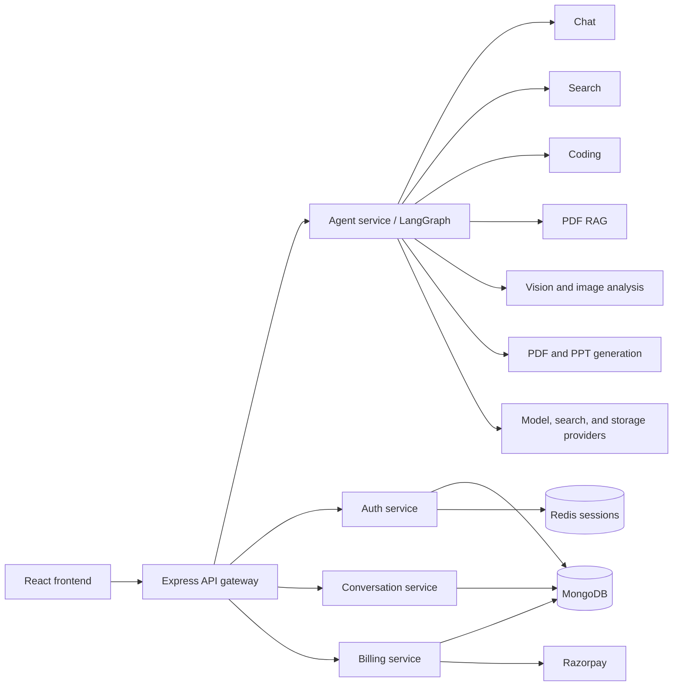

# AgentFlow AI

AgentFlow AI brings chat, coding, web search, document analysis, image tools, and document generation into one app. The React frontend connects to a Node.js backend, where LangGraph routes requests to specialist agents.

## 📸 Screenshots

Screenshots below are from the local application. They show the main workflows and responsive workspace panels.

### Welcome and workspace



### Chat and web search

| Assistant response | Web search with sources and images |
| --- | --- |
|  |  |

### Coding agent and artifacts

The coding agent can generate a small project and display its files alongside a live preview.

| Generated project preview | Generated source code |
| --- | --- |
|  |  |

### PDF question answering

Upload a PDF and ask questions grounded in its contents.

| PDF attached in the composer | Answer based on the uploaded PDF |
| --- | --- |
|  |  |

### Credits and plans



The screenshot below shows a successful Razorpay credit purchase.



## ✨ Features

### 🤖 Multi-agent assistant

- **Automatic routing:** send a prompt in Auto mode and the workflow chooses a suitable specialist.
- **Manual agent selection:** choose Chat, Coding, PDF, PPT, Image, or Search from the message composer.
- **Conversation memory:** continue chats from the recent conversation list; conversation messages are persisted by the backend.
- **Markdown responses:** headings, lists, links, tables, and code are rendered in chat.
- **Code readability:** code blocks use syntax highlighting and include a copy action.
- **Voice input:** dictate prompts with browser speech-recognition support.
- **Prompt suggestions:** start from example tasks on the new-chat screen.

### 🧠 Specialist agents

| Agent | What it does |
| --- | --- |
| **Chat** | Answers general questions and explains technical topics in a conversational format. |
| **Coding** | Generates project files as artifacts, or helps with code explanations, reviews, debugging, optimization, conversion, and documentation. |
| **Search** | Searches the web, then passes results to the assistant to prepare a readable answer with source links and related images where available. |
| **PDF analysis (RAG)** | Extracts PDF text, splits it into overlapping chunks, retrieves the five most relevant chunks using embeddings and cosine similarity, and answers from that context. |
| **Image analysis** | Accepts an image and answers questions about its contents, including visible text, charts, and tables. |
| **Image generation** | Turns a text description into an enhanced image prompt, generates an image, and returns a view/download link. |
| **PDF generation** | Creates a structured PDF document from a requested topic and provides a download link. |
| **PowerPoint generation** | Creates a six-slide presentation from a topic and provides a `.pptx` download. |

PDF upload analysis and PDF generation are separate workflows: the former answers questions about an uploaded document; the latter creates a new document from a prompt.

### 💻 Coding workspace

- View generated artifacts in a side panel next to the conversation.
- Switch between generated source files and a rendered preview.
- Copy code and resize or expand the artifact panel.

### 👤 Conversation and account controls

- Create and revisit conversations from the sidebar.
- Rename conversations automatically from the first prompt.
- Delete an individual conversation from its options menu.
- Resize or collapse the conversation sidebar and artifact panel.
- Edit first and last name; email is shown as account information.
- Switch between light and dark themes.
- Sign in with Google through Firebase Authentication and sign out from the profile menu.

### 💳 Credits and billing

- View the current plan and available credit balance.
- Enter a custom credit amount and see its INR estimate.
- Compare discounted credit bundles.
- Create a Razorpay order and verify payment before updating the account balance.
- Reference rate is fetched from Frankfurter and cached briefly by the billing service.

Credit usage configured in the backend:

| Request type | Credits |
| --- | ---: |
| Chat | 1 |
| Search | 5 |
| Coding | 10 |
| PDF analysis or generation | 10 |
| PPT generation | 10 |
| Image analysis or generation | 10 |

## How a request flows

1. The frontend sends the prompt, selected agent, conversation ID, and optional uploaded file to the API gateway.
2. The gateway checks the user session and forwards the request to the agent service.
3. The LangGraph router selects a specialist based on the explicit selection, uploaded file type, or prompt classification.
4. The specialist calls its configured model or service, then returns a response or downloadable artifact.
5. Conversation messages and account state are handled by their respective services.



## 🛠️ Technology stack

| Area | Technologies |
| --- | --- |
| Frontend | React, Vite, Tailwind CSS, Redux Toolkit, Motion, Monaco Editor |
| API gateway | Node.js, Express, HTTP proxy, cookie parsing, CORS |
| Workflow orchestration | LangChain and LangGraph |
| Authentication | Firebase Authentication and Firebase Admin |
| Data and sessions | MongoDB, Mongoose, Redis |
| AI and retrieval | Groq, OpenRouter, Google Gemini, LangChain embeddings, local cosine-similarity retrieval |
| Search and image generation | Tavily search and Pollinations image generation |
| Payments | Razorpay Checkout and Orders API |
| Generated file storage | AWS S3 with presigned download links |
| Document processing | `pdf-parse`, `pdfkit`, `pptxgenjs` |

## 📁 Project structure

```text
AgentFlow AI/
├── backend/
│   ├── gateway/                 # API gateway, session protection, and service proxy
│   ├── services/
│   │   ├── agent/               # LangGraph workflow and specialist agents
│   │   ├── auth/                # Firebase login, profile, sessions, and credits
│   │   ├── billing/             # Quotes, Razorpay orders, and payment verification
│   │   └── chat/                # Conversation and message persistence
│   ├── shared/redis/            # Shared Redis connection
│   └── docker-compose.yml        # Local Redis service
├── frontend/
│   ├── src/components/          # Chat, sidebar, artifact, and billing UI
│   ├── src/features/            # API calls for auth-adjacent app flows
│   ├── src/redux/               # User, chat, message, and UI state
│   └── utils/                   # Frontend API and Firebase setup
└── docs/screenshots/            # README product screenshots
```

## ⚙️ Run locally

### Prerequisites

- Node.js and npm
- Docker (for local Redis) or a Redis URL
- MongoDB
- Firebase project credentials
- Provider credentials for the services you want to use (AI, search, Razorpay, and AWS S3)

### Frontend

```bash
cd frontend
npm install
npm run dev
```

Set the frontend environment values in `frontend/.env`:

```env
VITE_SERVER_URL=http://localhost:<gateway-port>
VITE_FIREBASE_API_KEY=your_firebase_web_api_key
VITE_RAZORPAY_KEY_ID=your_razorpay_key_id
```

### Backend

Start Redis from the backend directory:

```bash
cd backend
docker compose up -d redis
```

Install dependencies in `gateway` and each service package, configure the service environment variables, then run the gateway and the `auth`, `chat`, `billing`, and `agent` services. Each package provides a `dev` script.

Backend configuration includes service URLs and ports, `FRONTEND_URL`, `MONGODB_URI`, `REDIS_URL`, Firebase Admin credentials, model/search provider keys, Razorpay keys, and AWS S3 settings. Keep secrets in local environment files or your deployment platform's secret manager; never put backend credentials in Vite variables or commit them.

To build the frontend for static hosting:

```bash
cd frontend
npm run build
```

Configure the hosted frontend's `VITE_SERVER_URL` to point to a reachable API gateway and set the gateway's allowed `FRONTEND_URL` to the hosted site.

## ☁️ AWS deployment

The project uses **Amazon ECR** (Elastic Container Registry) to store Docker images and **Amazon ECS** (Elastic Container Service) to run the backend containers. The frontend is a static Vite build stored in S3 and delivered through CloudFront. No Vercel deployment is used.

The repository includes [`.github/workflows/deploy.yml`](.github/workflows/deploy.yml). On a push to `main`, it is designed to build and push the backend images, ask ECS to redeploy its services, upload `frontend/dist` to S3, and invalidate the CloudFront distribution. This workflow assumes the AWS resources, ECS task definitions, runtime configuration, and GitHub secrets below already exist.

AWS services such as Fargate, load balancers, managed databases, image storage, and data transfer can incur charges. Check current AWS pricing and configure a budget alert before creating production resources.

### AWS layout

| Component | AWS service | Purpose |
| --- | --- | --- |
| Frontend files | S3 | Stores the output of `npm run build`. |
| Frontend delivery | CloudFront | Serves the static app over HTTPS and caches frontend assets. Use Origin Access Control (OAC) so the bucket does not need public read access. |
| Container images | ECR | Holds one image for the gateway and each backend service. |
| Backend containers | ECS on Fargate | Runs the gateway, auth, chat, agent, and billing services. |
| HTTP entry point | Application Load Balancer | Routes public API traffic to the gateway. Keep the other services reachable only inside the VPC. |
| App files | S3 | Stores generated images and documents for presigned downloads. Use a separate bucket from the frontend. |
| Database and cache | MongoDB and Redis-compatible service | Stores accounts, payments, conversations, and session data. The included `docker-compose.yml` starts Redis for local development only. |
| Logs | CloudWatch Logs | Receives logs from ECS tasks. |

For MongoDB, use a managed MongoDB deployment that the ECS tasks can reach. For Redis in AWS, use a managed Redis-compatible cache or another private Redis deployment. Do not expose either database to the public internet.

### 1. Create ECR repositories and push images

Create private ECR repositories with the names used by the workflow:

```text
gateway
auth-service
chat-service
agent-service
billing-service
```

Configure the AWS CLI and Docker, then authenticate to ECR. Replace the example values with your AWS account and region:

```bash
aws ecr get-login-password --region <aws-region> \
  | docker login --username AWS --password-stdin <aws-account-id>.dkr.ecr.<aws-region>.amazonaws.com
```

Build and push each image from the `backend` directory. The build context must be `backend` because each Dockerfile copies shared code and service files from that context.

```bash
docker build -f gateway/Dockerfile -t <aws-account-id>.dkr.ecr.<aws-region>.amazonaws.com/gateway:latest .
docker push <aws-account-id>.dkr.ecr.<aws-region>.amazonaws.com/gateway:latest

docker build -f services/auth/Dockerfile -t <aws-account-id>.dkr.ecr.<aws-region>.amazonaws.com/auth-service:latest .
docker push <aws-account-id>.dkr.ecr.<aws-region>.amazonaws.com/auth-service:latest

docker build -f services/chat/Dockerfile -t <aws-account-id>.dkr.ecr.<aws-region>.amazonaws.com/chat-service:latest .
docker push <aws-account-id>.dkr.ecr.<aws-region>.amazonaws.com/chat-service:latest

docker build -f services/agent/Dockerfile -t <aws-account-id>.dkr.ecr.<aws-region>.amazonaws.com/agent-service:latest .
docker push <aws-account-id>.dkr.ecr.<aws-region>.amazonaws.com/agent-service:latest

docker build -f services/billing/Dockerfile -t <aws-account-id>.dkr.ecr.<aws-region>.amazonaws.com/billing-service:latest .
docker push <aws-account-id>.dkr.ecr.<aws-region>.amazonaws.com/billing-service:latest
```

Run these commands with the current directory set to `backend`. The Dockerfiles expose these container ports:

| ECS service | Container port |
| --- | ---: |
| Gateway | 8000 |
| Auth | 8001 |
| Chat | 8002 |
| Agent | 8003 |
| Billing | 8004 |

### 2. Create ECS services

Create an ECS cluster and Fargate task definitions for the five images. Each service needs its own task definition with the matching ECR image, port, CPU/memory allocation, environment configuration, and CloudWatch log group. Run the services in a VPC. Attach the Application Load Balancer to the gateway service; use private networking or ECS service discovery for calls from the gateway and agent service to internal services.

Set the service URLs in the gateway and agent service configuration to the internal DNS names or endpoints used by your ECS setup. Configure health checks and security groups so that the load balancer can reach the gateway and services can reach only the dependencies they need.

The ECS task execution role needs permission to pull from ECR and write logs. Give the application task role only the AWS permissions the application needs, such as access to its generated-files S3 bucket. AWS recommends separate task execution and task roles for these purposes. [ECS IAM roles](https://docs.aws.amazon.com/AmazonECS/latest/developerguide/ecs-iam-role-overview.html) · [ECS load balancing](https://docs.aws.amazon.com/AmazonECS/latest/developerguide/service-load-balancing.html)

### 3. Configure runtime secrets and dependencies

Set service configuration in ECS task definitions, preferably by referencing AWS Secrets Manager or Systems Manager Parameter Store values. At a minimum, configure:

- Gateway: `PORT`, `FRONTEND_URL`, service URLs, and `REDIS_URL`.
- Auth: `PORT`, `MONGODB_URI`, `REDIS_URL`, and Firebase Admin credentials.
- Chat: `PORT` and `MONGODB_URI`.
- Agent: `PORT`, `MONGODB_URI`, `REDIS_URL`, service URLs, model/search keys, and S3 settings.
- Billing: `PORT`, `MONGODB_URI`, `AUTH_SERVICE`, and Razorpay keys.

The auth service currently imports `backend/services/auth/serviceAccountKey.json` as a file. Do not commit this file. Make it available securely to the running container, or change the Firebase Admin setup to read credentials from a Secrets Manager value before building the production image.

The S3 client currently reads AWS credentials from environment variables. For production, prefer an ECS task role with narrowly scoped S3 permissions and configure the client to use the AWS SDK's task-role credentials instead of long-lived access keys.

### 4. Host the frontend with S3 and CloudFront

Create a private S3 bucket for the static site, then create a CloudFront distribution with that bucket as a regular S3 origin and Origin Access Control enabled. Set `index.html` as the default root object, require HTTPS, and configure SPA routing so application routes return `index.html`. Keep S3 Block Public Access enabled and grant CloudFront access through the bucket policy. [AWS secure static site guide](https://docs.aws.amazon.com/AmazonCloudFront/latest/DeveloperGuide/getting-started-secure-static-website-cloudformation-template.html) · [CloudFront OAC for S3](https://docs.aws.amazon.com/AmazonCloudFront/latest/DeveloperGuide/private-content-restricting-access-to-s3.html)

The frontend API address is compiled into the Vite build. Set `VITE_SERVER_URL`, `VITE_FIREBASE_API_KEY`, and `VITE_RAZORPAY_KEY_ID` in the frontend build environment. Point `VITE_SERVER_URL` to the gateway's HTTPS endpoint and set the gateway's `FRONTEND_URL` to the CloudFront domain. Only use browser-safe Firebase and Razorpay key IDs in Vite variables; never put server secrets there.

### 5. Configure GitHub Actions deployment

The workflow currently expects these GitHub Actions secrets:

| Secret | Used for |
| --- | --- |
| `AWS_REGION`, `AWS_ACCOUNT_ID` | ECR and ECS region/account. |
| `AWS_ACCESS_KEY`, `AWS_SECRET_ACCESS_KEY` | AWS credentials used by the workflow. |
| `ECS_CLUSTER` | ECS cluster name. |
| `GATEWAY_SERVICE`, `AUTH_SERVICE`, `CHAT_SERVICE`, `AGENT_SERVICE`, `BILLING_SERVICE` | ECS service names to redeploy. |
| `S3_BUCKET` | Frontend site bucket. |
| `CLOUDFRONT_DISTRIBUTION_ID` | Distribution to invalidate after upload. |

The frontend build step in the current workflow does not pass the `VITE_*` values into `npm run build`. Add them as GitHub Actions variables or secrets and expose them to that build step; otherwise the deployed frontend will not know the correct API URL or browser SDK keys. For AWS credentials, consider configuring GitHub Actions OIDC with an IAM role instead of storing long-lived AWS access keys. [ECR image push guide](https://docs.aws.amazon.com/AmazonECR/latest/userguide/getting-started-cli.html) · [GitHub Actions OIDC with AWS](https://docs.aws.amazon.com/IAM/latest/UserGuide/id_roles_providers_create_oidc.html)

After the AWS resources and settings are in place, pushing to `main` triggers the workflow. It pushes images tagged `latest`, forces ECS deployments, syncs the frontend build to S3, and invalidates CloudFront. The ECS task definitions must reference the same ECR repositories and `latest` tag for this current workflow to pick up each new image.

## 🔐 Security notes

- Never commit `.env` files, Firebase service-account JSON, AWS credentials, Razorpay secrets, or AI provider keys.
- Only browser-safe public configuration belongs in `VITE_*` variables.
- Add production frontend and backend URLs to the Firebase and Razorpay configurations where required.

## About the project

The project brings together agent routing, document retrieval, model integrations, microservices, saved conversations, payments, and generated code artifacts.

## 🤝 Contributing

Contributions are welcome! If you'd like to:
- Fix bugs 🐞
- Add new features ✨
- Improve UI/UX 🎨
- Write tests 🧪

Just fork this repo, make your changes, and open a Pull Request. Let's make it better together!

---

## 📧 Contact

For any queries, feedback, or collaboration ideas:

- 📬 Email: [maahirtaneja@gmail.com](mailto:maahirtaneja@gmail.com)

---

© 2026 Maahir Taneja | Built with Node.js, Express, React, MongoDB, Redis, and AWS.